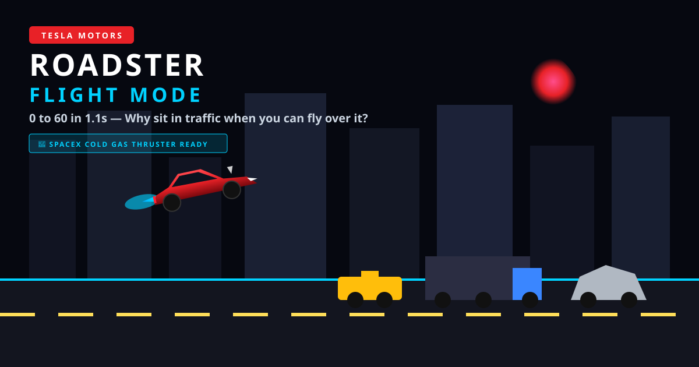

# 🚀 Tesla Roadster: Flight Mode

> **“0 to 60 in 1.1s. Why sit in traffic when you can fly over it?”**  
> 오늘 공개된 테슬라 차세대 로드스터 로켓 패키지(SpaceX Cold Gas Thruster)의 화제의 점프 & 자세 제어 발표를 모티브로 제작된 웹 아케이드 게임입니다.

<p align="center">
  
</p>

<p align="center">
  <a href="https://jeiel85.github.io/tesla-roadster/"></a>
  
  
  
  
</p>

---

## 🌟 라이브 데모 (Live Demo)
👉 **[지금 바로 플레이하기 (Play in Browser)](https://jeiel85.github.io/tesla-roadster/)**  
*(PC 브라우저 및 모바일 스마트폰/태블릿 터치 완벽 지원)*

---

## 📖 게임 소개 (About The Game)
SNS에서 폭발적으로 바이럴 중인 **테슬라 로드스터 신차 발표 현장**!  
차가 잠깐 하늘로 튀어오르고, **스페이스X 로켓 스러스터로 공중에서 자세를 수평으로 보정(RCS Stabilization)**한 뒤 사뿐히 착지하는 경이로운 장면을 기억하시나요?

이 게임은 출퇴근 시간 꽉 막힌 도심 고속도로에서, 로드스터의 **Cold Gas Thruster**를 가동해 정체된 차량들을 시원하게 뛰어넘고 날아가는 아케이드 러너 게임입니다.

---

## ✨ 핵심 기능 (Key Features)

- 🚀 **SpaceX Cold Gas Thruster 점화 & 호버링**:
  - 버튼을 탭하면 가벼운 홉 도약, 길게 누르면 최대 10,000 PSI의 고압 가스를 분사하며 지속 비행합니다.
- 🔄 **자율 자세 제어 시스템 (Autonomous RCS Stabilization)**:
  - 실제 발표의 핵심 디테일 구현! 공중에서 차체가 기울어지면 전·후방 RCS 노즐에서 미세 가스를 뿜으며 차체를 수평으로 자동 보정합니다.
- 🚙 **다양한 도심 교통체증 장애물**:
  - 거북이처럼 기어가는 일반 세단, 도심 옐로우 택시, 사이버트럭(Cybertruck), 거대한 컨테이너 트럭 및 버스.
- 👟 **루프 홉 (Roof Stomp Super Bounce)**:
  - 막힌 차량들의 지붕을 딛고 밟으면 더 높은 고도로 튀어오르는 슈퍼 바운스 액션!
- ⚡ **클로즈 콜 (Close Call / Flyover)**:
  - 정체 차량의 머리 위를 아슬아슬하게 스쳐 지나갈 때 발동하는 시네마틱 슬로우모션 & 대량 보너스 점수.
- 🔊 **Web Audio API 기반 자체 신스 오디오**:
  - 외부 오디오 파일 다운로드 없이 100% 브라우저 코드로 실시간 합성되는 로켓 제트 분사음, RCS 밸브음, 그리고 레트로 신스웨이브 BGM.
- 🌆 **네온 신스웨이브 패럴랙스 도심 야경**:
  - 사이버 선(Cyber Sun), 마천루 네온 빌딩, 고속도로 차선 애니메이션.
- 📱 **완벽한 모바일 터치 및 반응형 지원**:
  - 화면 터치만으로 직관적인 조작이 가능하며 120Hz 고주사율 디스플레이 및 레티나 해상도 지원.
- 𝕏 **SNS 공유 & 최고 기록 저장**:
  - 로컬스토리지에 최고 점수가 자동 보관되며, 원클릭으로 X(Twitter)에 기록 공유 가능.

---

## 🎮 조작법 (Controls)

| 플랫폼 | 조작키 | 동작 설명 |
| :--- | :--- | :--- |
| **PC 키보드** | `Space` / `W` / `↑` | **짧게 탭**: 점프 (Hop)<br>**길게 홀드**: 로켓 스러스터 지속 분사 (호버링/상승) |
| **마우스** | 좌클릭 | **클릭**: 점프 / **누르고 있기**: 스러스터 분사 |
| **모바일 / 터치** | 화면 터치 | **탭**: 점프 / **터치 홀드**: 스러스터 분사 |
| **일시정지** | `P` 또는 `ESC` | 게임 일시정지 / 재개 |

---

## 🛠️ 기술 스택 (Tech Stack)

- **Language & Engine**: Pure Modern JavaScript (ES6 Modules), HTML5 Canvas 2D
- **Styling**: CSS3 (Glassmorphism, High-tech Tesla Minimalist HUD)
- **Audio**: Web Audio API (Procedural Jet Noise & FM Synthesizer)
- **Dependencies**: **0 (Zero external dependencies / No bundlers required)**

---

## 💻 로컬 실행 방법 (Run Locally)

별도의 빌드 과정(npm, webpack 등) 없이 정적 파일로 즉시 실행할 수 있습니다.

```bash
# 1. 리포지토리 클론
git clone https://github.com/jeiel85/tesla-roadster.git
cd tesla-roadster

# 2. 로컬 웹서버 실행 (ES6 모듈 브라우저 보안 정책 대응)
# Python 3
python -m http.server 8080

# 또는 Node.js npx
npx serve .
```
브라우저에서 `http://localhost:8080`을 열어 플레이하세요!

---

## 📄 라이선스 (License)
This project is licensed under the MIT License - see the [LICENSE](LICENSE) file for details.
